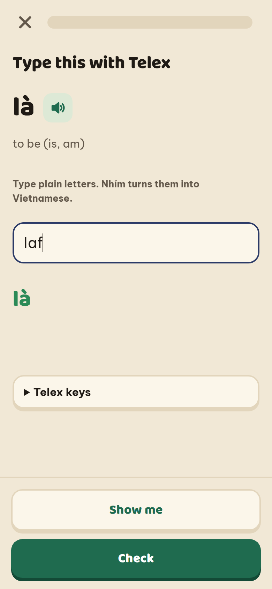
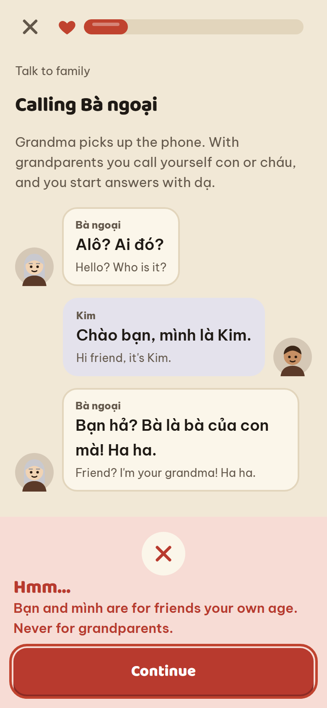
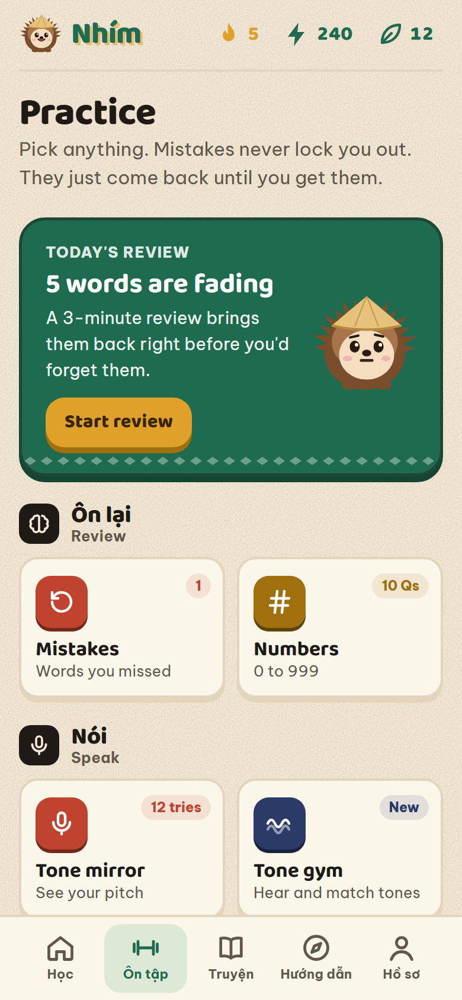

# Nhím

Learn Vietnamese in short, game-like lessons. Nhím (Vietnamese for "hedgehog") is the mascot.

**Try it:** https://audreypham2007-spec.github.io/nhim/ · [About Nhím](https://audreypham2007-spec.github.io/nhim/about.html)

Made by Audrey Pham, Communication Sciences and Disorders, California State University, Fullerton.

  
  
  
  
  
  
  

## Why I built this

Vietnamese has six tones. A change in pitch changes the word: ma (ghost), má (mother), mà (but), mả (grave), mã (horse), mạ (rice seedling). Most apps treat tones as a footnote. Nhím teaches them first and draws each one as a pitch line, so you see what your voice should do. Then you say the word into your microphone and see your own pitch line on top.

I spoke Vietnamese only at home, and when I started going to an American public school, my words were jumbled up. Bilingual children are often misidentified with speech disorders. I was one of them. Now I study speech-language pathology, and I care about bilingual speakers. Many Vietnamese American students understand Vietnamese at home but can't read or write it. Nhím is built for them:

- It accepts both Northern and Southern words (vâng/dạ, bố/ba, mẹ/má, đắt/mắc) and shows the learner's home dialect first.
- It teaches family pronouns early, with a tap-through family tree, because "I" and "you" depend on who you're talking to. Then you practice them in conversations with Bà, Ông, and a friend's mom, who react to your choices.
- Heritage speakers can skip ahead during setup, and pick what they want most (speaking with family, or reading and writing). Nhím mixes in more of that.
- It teaches Telex typing, because many heritage speakers can speak Vietnamese but have never typed it.
- Family voices: a parent or grandparent records words and sentences, and Nhím plays their voice instead of the computer voice. You learn the Vietnamese your family actually speaks, in their accent.

## Features

**Course**
- The six tones, then 16 units: Greetings, Family, Numbers, Food, Questions, Daily life, Feelings, Colors, Time and dates, Shopping and money, Getting around, Weather, Body and health, School and work, At home, and Tết.
- 350+ words and sentences, 16 dialogue stories (one per unit), and a unit check at the end of each unit.
- 10 exercise types: word cards, multiple choice, listening, type what you hear, match pairs, sentence building (both directions), fill in the blank, typing, tone identification, and pitch shape matching.

**Tone tools**
- Each tone drawn as a pitch contour on a 5-level scale. A dot traces the line while the word plays.
- Tone mirror: say a word into the microphone and see your pitch line next to the target. A short "Say it" step also appears inside lessons.
- Southern mode: hỏi and ngã sound the same in the South, so either answer counts in tone exercises and the tone mirror. It scores the shape of the line, not how high your voice is, and gives a tip for each tone. It runs in the browser. Nothing is recorded or saved.
- A tone gym, and a tone mix-up chart in your profile that shows which tones you confuse with which.

**Talk to family**
- Six branching conversations: a phone call with Bà ngoại, a friend's mom, Tết with Ông nội, bargaining at the market, an older cousin, and a call from Ba. Each choice is rated, the relative reacts, and a note explains why: tôi vs. con, bạn vs. bà, dạ and ạ, inviting elders to eat first, never asking how much lì xì is inside.

**Family chat**
- Read family texts the way they're really sent: no accent marks and shortcuts like ko, dc, j, r. Pick the right full spelling, then reply with Telex.

**Family voices**
- Record any word, sentence, or story line. The recording replaces the computer voice everywhere in the app, including listening exercises.
- Works even on devices with no Vietnamese computer voice: once 8 or more words are recorded, listening practice turns on for those words.
- Recordings stay on the device. Save them as a voice pack file to share with cousins or move to another phone.

**Practice**
- Spaced repetition: each word has a strength from 0 to 5 and comes back 10 minutes, 1 day, 3 days, 1 week, 2 weeks, or a month later.
- A mistakes list that clears a word once you get it right twice.
- A number trainer for 0 to 999 that covers mốt, lăm, tư, and linh or lẻ.
- Telex typing practice with a built-in Telex engine (aa → â, dd → đ, s → sắc), so it works on any keyboard.

**Motivation**
- XP, daily goal, and day streak. No hearts: mistakes never lock you out, they come back at the end of the lesson until you get them right.
- Three daily quests and 13 badges.
- Sound effects, confetti, and a mascot that reacts to right and wrong answers.

**Built for real use**
- Installs on a phone home screen and works offline.
- Works with a keyboard: number keys pick answers, Enter checks.
- Screen reader labels, visible focus, light and dark mode, and reduced motion support.
- Backup and restore your progress as a file.

## How it works

| File | What it does |
|---|---|
| `js/data.js` | All course content: tones with pitch contours, units, fill-in items, and stories. |
| `js/app.js` | State, the lesson path, exercise builders, grading, spaced repetition, quests, badges, and every screen. |
| `js/ui.js` | The hedgehog drawn in SVG, unit scenery, tone graphs, story characters, speech, and synthesized sound effects. |
| `js/pitch.js` | The tone mirror: microphone pitch tracking (YIN), smoothing, and shape scoring. |
| `js/telex.js` | The Telex engine and the typing trainer. |
| `js/talk.js` | Talk to family conversations. |
| `js/chat.js` | Family chat: reading texts without accent marks and replying. |
| `js/voices.js` | Family voices: recording (MediaRecorder), storage (IndexedDB), playback, and voice pack files. |
| `css/styles.css` | All styling. The look comes from Đông Hồ folk woodblock prints: grainy điệp paper and the old pigments. Dark mode is based on sơn mài lacquer. |
| `about.html` | The About page. |
| `sw.js` | Offline support. |

Key parts of `app.js`:
- `buildLesson()` turns a unit's words and phrases into a lesson.
- `grade()` checks answers. Typed text is normalized (Unicode NFC, lowercase, no punctuation). An answer with missing tone marks still counts, with a reminder.
- `toneOf()` breaks a syllable into letters and marks (Unicode NFD) to find its tone.
- `srsHit()` updates a word's strength and next review time.
- `numVi()` spells numbers using Vietnamese counting rules.

## Tech

HTML, CSS, and vanilla JavaScript. No framework, no build step, no server, no tracking. Audio uses the browser's Vietnamese voice (Web Speech API). Sound effects and the tone mirror use the Web Audio API. Progress saves in the browser (localStorage). Hosted on GitHub Pages.

## Run it on your computer

Download the repository and open `index.html` in a browser.

The tone mirror needs microphone access, which some browsers only allow from a web server. In the project folder, run `python -m http.server 8000` and open http://localhost:8000.

## Tests

`tests/run.html` checks the Telex engine, tone scoring, and every story, conversation, and chat message (17 checks). Start a local server (`python -m http.server 8000`) and open http://localhost:8000/tests/run.html. The heading says PASS or FAIL.

## Roadmap

- A starter voice pack recorded by native speakers from the North and the South.
- A study with Vietnamese American heritage speakers: a tone listening test before and after 4 weeks of use.

## Credits

Built with AI coding assistance (Claude). Native speaker review of the Vietnamese content is welcome: open an issue.
