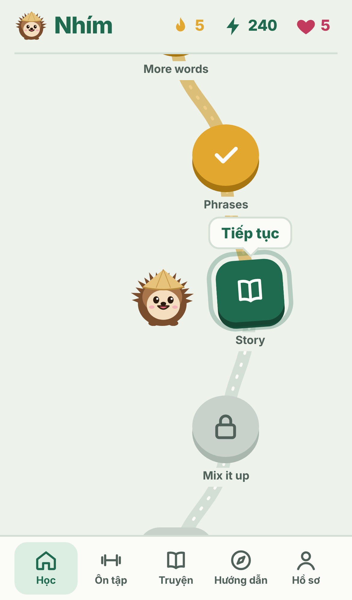
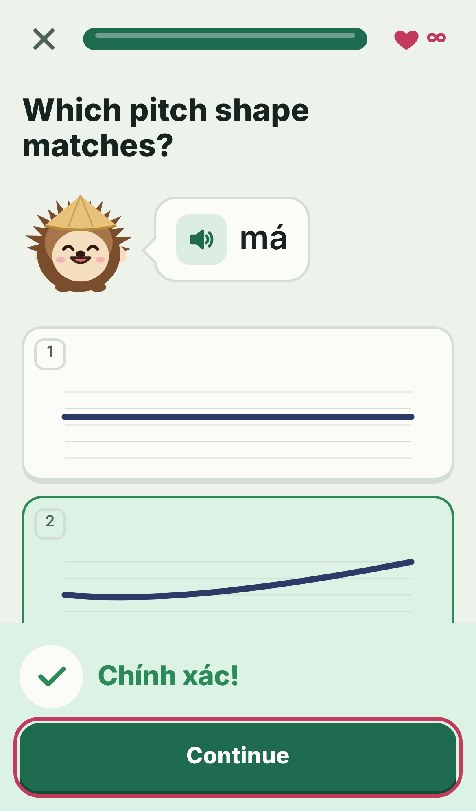
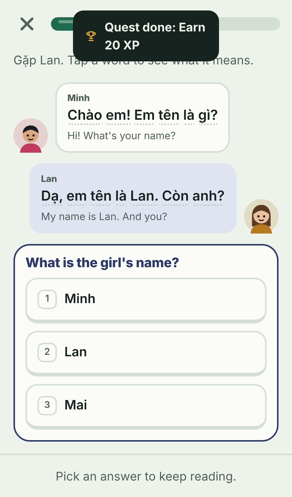
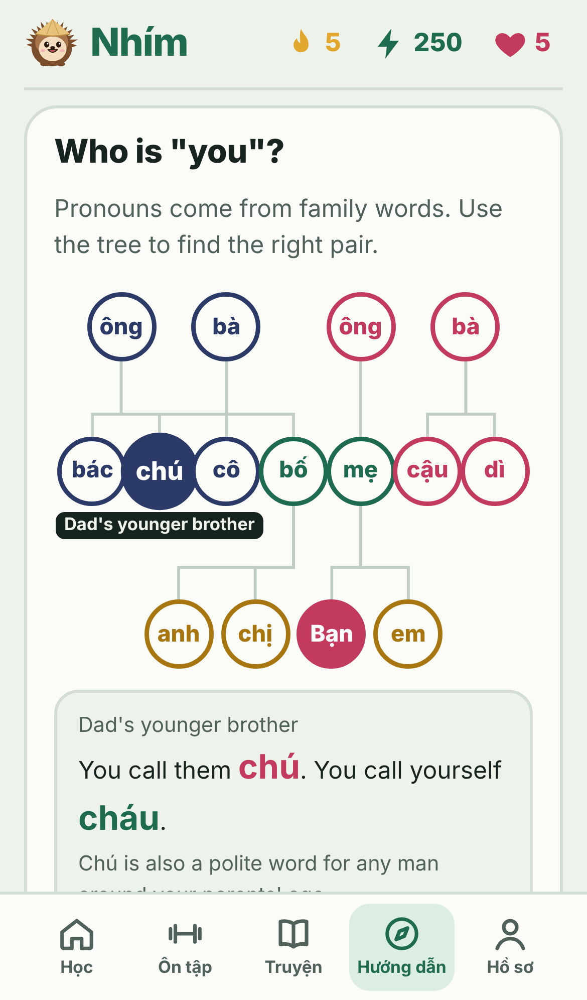

# Nhím

Learn Vietnamese in short, game-like lessons. Nhím (Vietnamese for "hedgehog") is the mascot.

**Try it:** https://audreypham2007-spec.github.io/nhim/

Made by Audrey Pham, Communication Sciences and Disorders, California State University, Fullerton.

  
  
  
  

## Why I built this

Vietnamese has six tones. A change in pitch changes the word: ma (ghost), má (mother), mà (but), mả (grave), mã (horse), mạ (rice seedling). Most apps treat tones as a footnote. Nhím teaches them first and draws each one as a pitch line, so you see what your voice should do.

I study speech-language pathology, and I care about bilingual speakers. Many Vietnamese American students understand Vietnamese at home but can't read or write it. Nhím is built for them:

- It accepts both Northern and Southern words (vâng/dạ, bố/ba, mẹ/má, đắt/mắc) and shows the learner's home dialect first.
- It teaches family pronouns early, with a tap-through family tree, because "I" and "you" depend on who you're talking to.
- Heritage speakers can skip ahead during setup.

## Features

**Course**
- The six tones, then 16 units: Greetings, Family, Numbers, Food, Questions, Daily life, Feelings, Colors, Time and dates, Shopping and money, Getting around, Weather, Body and health, School and work, At home, and Tết.
- 350+ words and sentences, 8 dialogue stories, and a unit check at the end of each unit.
- 10 exercise types: word cards, multiple choice, listening, type what you hear, match pairs, sentence building (both directions), fill in the blank, typing, tone identification, and pitch shape matching.

**Tone tools**
- Each tone drawn as a pitch contour on a 5-level scale. A dot traces the line while the word plays.
- A tone gym, and a tone mix-up chart in your profile that shows which tones you confuse with which.

**Practice**
- Spaced repetition: each word has a strength from 0 to 5 and comes back 10 minutes, 1 day, 3 days, 1 week, 2 weeks, or a month later.
- A mistakes list that clears a word once you get it right twice.
- A number trainer for 0 to 999 that covers mốt, lăm, tư, and linh or lẻ.

**Motivation**
- XP, daily goal, day streak, and hearts that refill over time.
- Three daily quests and 13 badges.
- Sound effects, confetti, and a mascot that reacts to right and wrong answers.

**Built for real use**
- Installs on a phone home screen and works offline.
- Works with a keyboard: number keys pick answers, Enter checks.
- Screen reader labels, visible focus, light and dark mode, and reduced motion support.
- Backup and restore your progress as a file.

## How it works

| File | What it does |
|---|---|
| `js/data.js` | All course content: tones with pitch contours, units, fill-in items, and stories. |
| `js/app.js` | State, the lesson path, exercise builders, grading, spaced repetition, quests, badges, and every screen. |
| `js/ui.js` | The hedgehog drawn in SVG, unit scenery, tone graphs, story characters, speech, and synthesized sound effects. |
| `css/styles.css` | All styling. The palette comes from Đông Hồ folk woodblock prints. |
| `sw.js` | Offline support. |

Key parts of `app.js`:
- `buildLesson()` turns a unit's words and phrases into a lesson.
- `grade()` checks answers. Typed text is normalized (Unicode NFC, lowercase, no punctuation). An answer with missing tone marks still counts, with a reminder.
- `toneOf()` breaks a syllable into letters and marks (Unicode NFD) to find its tone.
- `srsHit()` updates a word's strength and next review time.
- `numVi()` spells numbers using Vietnamese counting rules.

## Tech

HTML, CSS, and vanilla JavaScript. No framework, no build step, no server, no tracking. Audio uses the browser's Vietnamese voice (Web Speech API). Sound effects use the Web Audio API. Progress saves in the browser (localStorage). Hosted on GitHub Pages.

## Run it on your computer

Download the repository and open `index.html` in a browser.

## Roadmap

- Pitch tracker: say a word into the microphone and see your pitch next to the target tone.
- Recordings from native speakers in place of the browser voice.
- A study with Vietnamese American heritage speakers: a tone listening test before and after 4 weeks of use.

## Credits

Built with AI coding assistance (Claude). Native speaker review of the Vietnamese content is welcome: open an issue.
